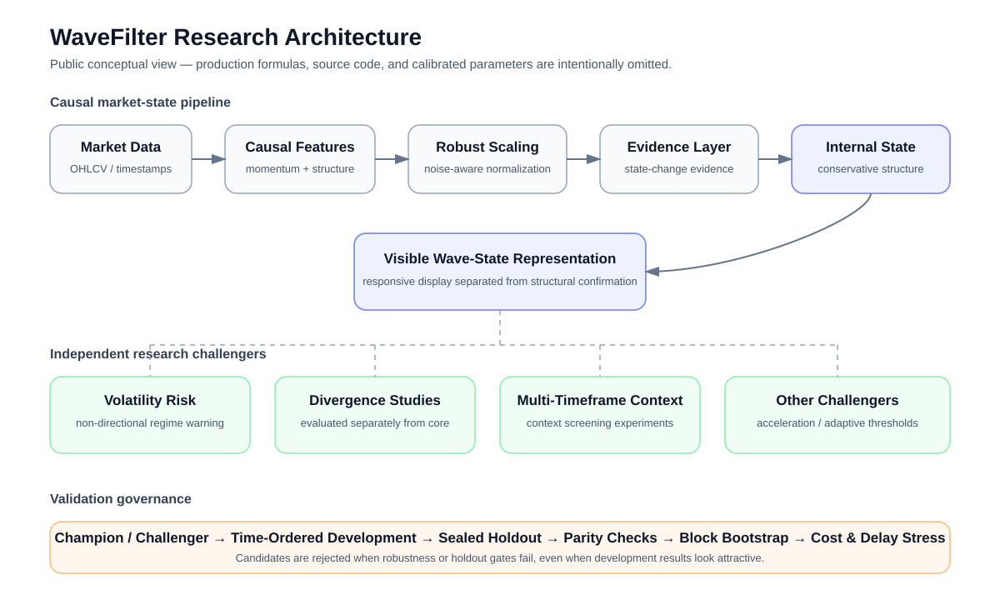
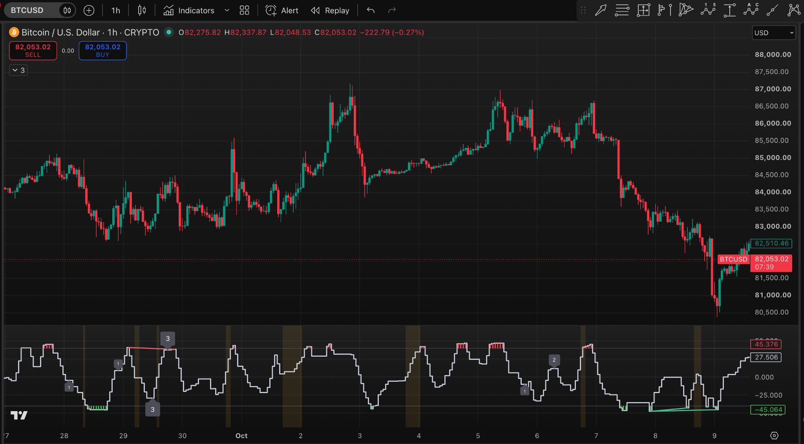
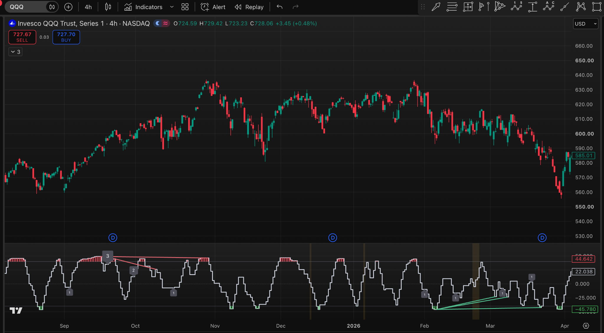
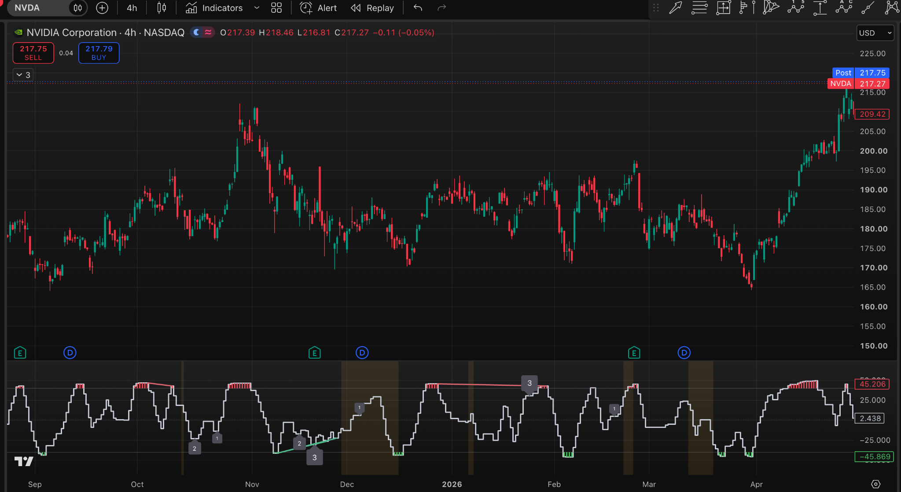
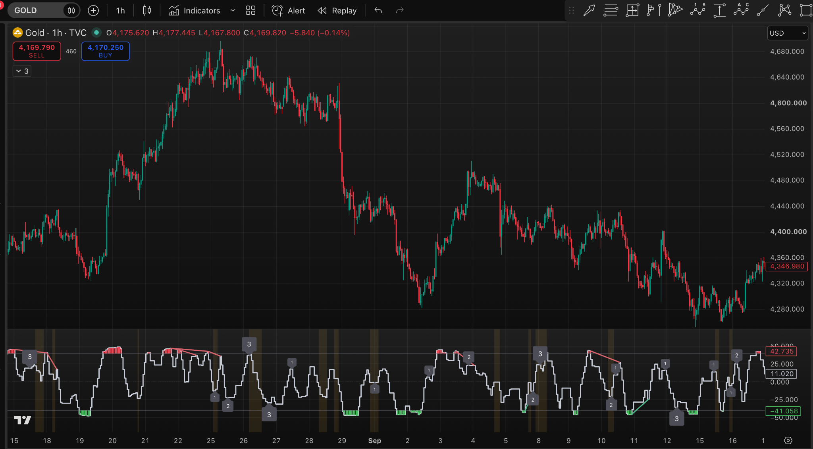

# 波段过滤器 · WaveFilter Research

**Research on causal market-state filtering, volatility risk, and robust validation in financial time series.**

> **Can a market-state filter respond to meaningful structural change without becoming overly sensitive to short-lived noise?**

My work on WaveFilter focuses on separating a responsive visible wave from a more conservative structural state, evaluating new features through a Champion / Challenger process, and documenting why some ideas are retained or rejected. This repository presents that research process, a runnable synthetic evaluation example, and selected indicator screenshots.

This sub-chart project is named **波段过滤器 (WaveFilter)**. The main-chart work was separated from the same development process to support additional functionality and is documented as [**趋势过滤器 (Trend Filter)**](https://github.com/xiaoxinbuxin/TrendFilter-Research). The two projects share their development origin; evidence for one does not validate the other.

## Start here

| Material | What you can inspect | Evidence boundary |
|---|---|---|
| [Executed public demo](results/public_demo_results.md) | Sample counts, event rates, uncertainty, boundary audit, and chart; [notebook with saved outputs](notebooks/public_demo.ipynb) | Synthetic evaluation example; does not reproduce the production indicator or private-study results |
| [Research decisions](#selected-research-decisions) | Retained and rejected directions and the reasoning behind them | Author-reported private research; [public evidence limits](results/private_study_context.md) |
| [Market examples](#current-cross-market-examples) | Visible output on BTCUSD, QQQ, NVDA, and TVC Gold | Selected screenshots; not evidence of profitability or cross-market statistical validity |

Production source, exact formulas, calibrated parameters, and the private research pipeline are outside this repository. See [Scope](#scope) and [NOTICE.md](NOTICE.md).

## Reproducible public demo

The [executed results snapshot](results/public_demo_results.md) provides the actual synthetic results, including unfavorable outcomes. The [notebook](notebooks/public_demo.ipynb) contains saved tables and a chart, so the output can be inspected without running code.

The example demonstrates causal feature construction, complete future labels, a purged chronological development / holdout split, non-directional volatility-risk evaluation, and block-bootstrap uncertainty. It does not reproduce the private WaveFilter algorithm or its reported results. The original public-demo settings and seeds are retained.

[Run instructions](notebooks/README.md) explain how to regenerate the artifacts. Dependencies are in [requirements.txt](requirements.txt), with the snapshot's exact versions in [public_demo_run.json](results/public_demo_run.json). GitHub Actions runs boundary regression checks, executes the notebook, and checks the generated numeric tables.

## Selected research decisions

The decisions below are author-reported summaries of private research. The public repository does not independently reproduce those studies. Previously published numerical claims and the limits of their public evidence are collected in [Private-study context](results/private_study_context.md). For directly inspectable output, see the separate [executed synthetic demo](results/public_demo_results.md).

| Research component | Result | Decision |
|---|---:|---|
| Core wave-state filter | Stable across repeated challenger tests | **Champion retained** |
| Standard volatility warning | Reported higher future-volatility frequency in a private study; public evidence is limited to a summary | **Retained as non-directional risk information** |
| Multi-timeframe confirmation | Development evidence did not survive execution-cost / holdout requirements | **Rejected** |
| Divergence trading extensions | Promising visually, but not robust enough in sealed validation | **Not promoted to trading logic** |
| Adaptive-threshold / acceleration experiments | Failed stability or regret guardrails | **Rejected** |

The negative results are intentional. They are part of the project because they explain why the final system is simpler than the full set of ideas I tested.

A compact decision record is available in [`results/validation_summary.csv`](results/validation_summary.csv), with more context in [`docs/experiment_history.md`](docs/experiment_history.md).

## Development background

I began by combining **SKDJ, RSI, and Stochastic RSI**, but extra confirmation introduced delay and complexity. That led me toward directional-pressure state logic, separation of the visible wave from structural confirmation, and systematic testing of proposed changes.

The current public milestone is **v21.8.24** (September 2026). The development record describes retaining the core wave-state framework and a single non-directional volatility-warning layer while rejecting or restricting several alternative modules.

For the full account, read the [development story](docs/development_story.md); for a shorter stage-by-stage account, use the [timeline](docs/development_timeline.md).

## System overview

The visible wave and the internal structural state are treated separately, allowing visual responsiveness without making every fluctuation a formal reversal. Volatility warnings are also separate from directional claims: they concern a higher-volatility environment, not whether price will rise or fall.

See [Architecture](docs/architecture.md) for the conceptual pipeline and module responsibilities.

## How I test new ideas

A stable **Champion** is kept while each new idea is tested as a separate **Challenger**. The documented workflow moves from development diagnostics through causal and platform-parity checks, cross-dataset evaluation, frozen rules and pass/fail gates, and a sealed holdout to a retain, restrict, or reject decision.

Events are evaluated from the bar where they become observable, using time-ordered data. Depending on the experiment, checks include confirmation delay, reversals, MFE/MAE, remaining opportunity, transaction costs, slippage, and block-bootstrap uncertainty.

The public protocol is described in [Methodology](docs/methodology.md) and [Validation framework](docs/validation_framework.md). These documents describe the research process; the directly runnable public example is the synthetic demo above.

## Current Cross-Market Examples

These selected TradingView screenshots illustrate the current visible WaveFilter output across cryptocurrency, an equity ETF, an individual equity, and a commodity. They show visual state behavior in different market contexts; they do not establish strategy profitability or cross-market statistical validity and are not trading recommendations.

### Bitcoin / BTCUSD (CRYPTO) — 1H

The visible wave repeatedly occupies the lower extreme region during the sustained decline on the right of the chart, then rises as price rebounds. The snapshot illustrates lower-zone persistence and recovery in a cryptocurrency context.

### Invesco QQQ Trust / QQQ (NASDAQ ETF) — 4H

The ETF view spans an advance, repeated pullbacks, and a later decline with a rebound. The lower panel shows alternating wave states and repeated visits to both extreme regions across that sequence.

### NVIDIA / NVDA (NASDAQ) — 4H

The individual-equity view shows repeated upper- and lower-zone episodes through advances, declines, and recoveries. Numbered annotations and shaded intervals provide visible context alongside the wave.

### Gold (TVC) — 1H

The TVC Gold view covers an initial advance followed by a decline and several rebounds. The visible wave alternates between extreme regions and intermediate states as the price path changes.

Notes for the examples are in [`figures/real_examples.md`](figures/real_examples.md).

## Repository guide

| Directory | Contents |
|---|---|
| [docs/](docs/README.md) | Development history, architecture, methodology, validation, and limitations |
| [results/](results/README.md) | Executed synthetic outputs and separate private-study decision summaries |
| [notebooks/](notebooks/README.md) | Public synthetic demo and run instructions |
| [figures/](figures/README.md) | Architecture, synthetic chart, and market screenshots |
| [tests/](tests/test_public_demo.py) | Public-demo labeling and split-boundary regression checks |

## Scope

Most documented experiments use cryptocurrency data across a limited set of assets, timeframes, periods, and exchange feeds. Results should not be assumed to generalize automatically to other markets.

This repository is for academic, research, and portfolio use. It does not provide automated trading instructions or guarantee profitability after costs, latency, slippage, and risk constraints.

The production Pine Script, exact parameterization, private AutoLab implementation, raw private datasets, and execution-specific rules remain private. See [`NOTICE.md`](NOTICE.md) for the public disclosure boundary.
