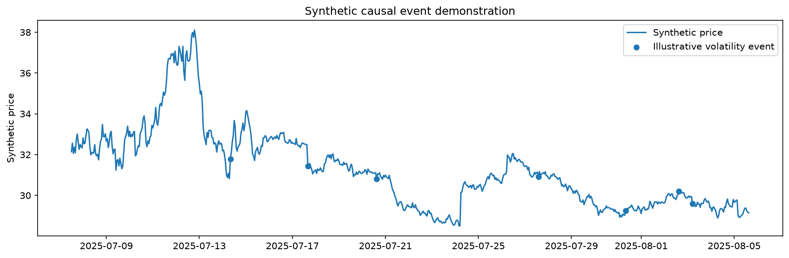

# Public Synthetic Demo — Executed Results

Generated by [`notebooks/public_demo.ipynb`](../notebooks/public_demo.ipynb). **Synthetic data only; these are not WaveFilter production results or the privately reported study statistics.**

The notebook retains its original illustrative event settings and random seeds. This run corrects missing-history labels, incomplete future windows, and labels crossing the development/holdout boundary. The data and settings were already public; this is a protocol demonstration, not a newly sealed study.

## Evaluation definition

An event is observable at the current bar close. The target is the mean absolute return over the next six bars, compared with a prior-history reference. The baseline includes all eligible bars in the same split, including event bars. Lift is the conditional event rate minus that baseline, not a treatment effect.

## Results

| Split | Eligible bars | Events | Baseline high-volatility rate | Event high-volatility rate | Lift (percentage points) |
|---|---:|---:|---:|---:|---:|
| development | 4326 | 39 | 22.77% | 23.08% | +0.31 |
| holdout | 1494 | 21 | 16.33% | 14.29% | -2.05 |

Holdout illustrative 90% block-bootstrap percentile interval for lift: **-12.52 to +11.98 percentage points**.
72-bar blocks; 2,000 requested resamples; 2,000 valid; 0 skipped because no events were sampled.
Fraction of valid resamples with positive lift: 37.75%. This is descriptive and is neither a posterior probability nor a p-value.

The interval includes zero, so this example does not establish a positive lift. No settings were retuned to make this result favorable.

A small number of events, changing synthetic regimes, and a single fixed block length limit interpretation. The interval does not account for model-selection uncertainty.

## Boundary audit

| Check | Rows |
|---|---:|
| original_bars | 6000 |
| history_unavailable | 168 |
| incomplete_future_window | 6 |
| valid_label_rows | 5826 |
| development_rows_purged_at_boundary | 6 |
| development_evaluated | 4326 |
| holdout_evaluated | 1494 |

Holdout starts at **2025-07-07 12:00:00** in the synthetic timeline. Every retained development label finishes before that point. Missing-history and incomplete-future rows are excluded.

## Synthetic chart

## Reproduce and inspect

- [Executed notebook](../notebooks/public_demo.ipynb) — source, saved tables, interval, and chart.
- [Run instructions](../notebooks/README.md).
- [Aggregate metrics](public_demo_summary.csv), [bootstrap summary](public_demo_bootstrap.csv), and [boundary audit](public_demo_split_audit.csv).
- [Software versions and public-demo settings](public_demo_run.json).
- [Separate context for previously reported private-study numbers](private_study_context.md).
